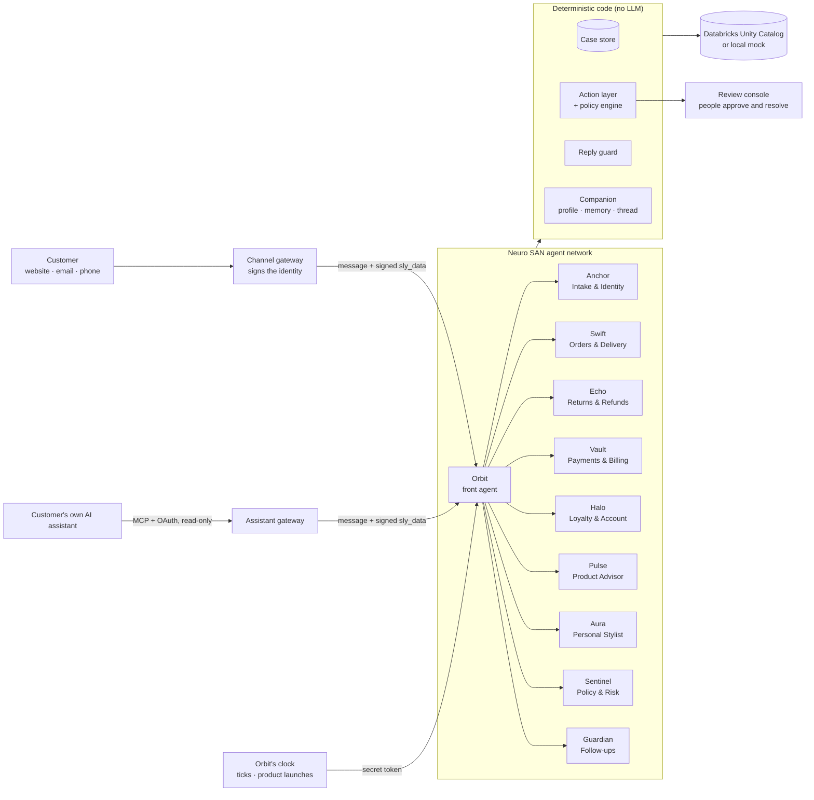

# Customer AI Companion: Everly — Your AI Companion, Always by Your Side

**Everly from ACME Retail.** Everly is the AI companion that ACME Retail, an online clothing store, gives each of its
customers: one companion per customer, for life. Behind that one name is a **multi-agent team** built on
[Neuro SAN](https://github.com/cognizant-ai-lab/neuro-san): a front agent that talks to the customer and specialist
agents for orders, returns, payments, loyalty, products, styling and policy, all working on one shared case.

**Code decides, the model talks.** Who the customer is, what may be changed, how much may be refunded, when to follow
up and whom to invite are decided by deterministic, tested code. The language model plans the work and writes the
conversation; it can never pick the customer, raise an amount or claim something was done when it wasn't.

**Demo video (10:44):** [`demo/everly-demo10-v2-20261024-234928.mp4`](demo/everly-demo10-v2-20261024-234928.mp4)
(subtitles: [`.srt`](demo/everly-demo10-v2-20261024-234928.srt)). A refund fixed end to end, a high-value refund
approved by a person and followed by the Resolution Guardian, a Personal Stylist launch, product suggestions, and a
customer's own AI assistant asking Everly over MCP. Recorded on 2026-10-24, before the agent network file was
renamed: the build card still shows its old name, `support_multi_agent.hocon`.

## Highlights

- **Zero-question support.** The customer is identified by the channel they use, so Everly never asks for anything
  the system can look up: no order numbers, no email addresses, no "can you confirm your name".
- **A multi-agent team.** Ten agents with clear roles, coordinated over one shared case record held in SQLite, not
  in the model's memory.
- **Identity checked in code.** Gateways sign the customer's identity, and the agent server verifies it. The model
  never sees or chooses who the customer is.
- **Safe actions.** Every refund, return, cancellation or trace goes through an eight-step checking layer: identity,
  ownership, policy, idempotency, execution, then confirmation by reading the record back, with an audit trail.
- **Replies checked against the records.** Before the customer sees a reply, code checks it for invented reference
  numbers or amounts, and for "it's done" when nothing was done.
- **Resolution Guardian.** Open issues are followed after the chat ends, until the refund lands or the parcel
  arrives, with updates, delay notices and hand-offs to a person when a deadline passes.
- **Companion memory.** A profile built from the customer's own data, a running thread across conversations, and
  preferences remembered only after the customer says a clear yes.
- **Personal Stylist Mode (opt-in).** When a product launches, customers are invited only when their purchase
  history shows it really suits them, with a reason that names an item they own.
- **Bring your own AI assistant.** Customers can connect Claude, ChatGPT or another assistant over MCP with OAuth
  consent. It can read their orders and ask questions, but it can't change anything.
- **People stay in the loop.** Approvals above limits, specialist reviews and hand-offs go to a review console, and
  every approval is checked again against fresh data.
- **Measured.** Scenario, journey, Guardian and assistant evaluations; about 600 unit tests; a scripted test model
  that runs the whole network with no LLM calls.

## Architecture



1. A **channel gateway** (website, email, phone, or the assistant gateway) authenticates the customer and sends the
   message with signed `sly_data`. Neuro SAN keeps `sly_data` away from every model.
2. **Orbit**, the front agent, starts each turn with **Anchor**, which resolves the identity in code, opens or
   continues the case and splits the message into one issue per request.
3. Orbit routes each issue to the right **specialist**. Specialists read the data through coded tools that store
   every result as evidence on the issue, and record their findings and any proposed action.
4. A proposed action goes through the **Controlled Action & Verification Layer**: it runs only if identity, policy
   and the records all agree, and it counts as done only when the system of record confirms it.
5. After each turn the gateway runs `finish_turn`. The reply guard checks the reply, anything still unresolved goes
   to a person, the Guardian starts watching issues whose outcome is still to come, and the turn is added to the
   customer's thread.

## The agents

The display names appear in the demo only. To the customer, the whole team is **Everly**.

| Agent | Role | What it does |
|---|---|---|
| **Orbit** (`support_orchestrator`) | Front agent | The only agent that talks to the customer. Coordinates the specialists over the shared case, submits the actions they propose, hands issues to people. Gets the customer's companion notes before each model call. |
| **Anchor** (`intake_identity`) | Intake & Identity | Resolves who the customer is (in code), opens or continues the case, records one issue per request, reads earlier support contacts. |
| **Swift** (`order_delivery`) | Orders & Delivery | Orders, items, shipment timelines, stalled parcels, split shipments. Can propose a carrier trace or a cancellation. |
| **Echo** (`returns_refunds`) | Returns & Refunds | Return eligibility and windows, refund status, stuck or failed refunds. Can propose a return, refund, refund re-trigger or store credit. |
| **Vault** (`payments_billing`) | Payments & Billing | Payment summaries and consistency checks. Read-only: billing claims go to the billing team as a review. |
| **Halo** (`loyalty_account`) | Loyalty & Account | Tier and points. Read-only: changes go to a person. |
| **Pulse** (`product_advisor`) | Product Advisor | Suggestions from the recommendation engine: replacements, complements, alternatives, upgrades, "bought together", each with a reason and in-stock sizes and colours. |
| **Aura** (`stylist`) | Personal Stylist | Personal Stylist Mode: the customer's picks, why each one suits them, "not for me" feedback; releases held invites and runs launches. |
| **Sentinel** (`policy_risk_escalation`) | Policy & Risk | A dry-run policy decision (allow, needs approval, escalate, deny) on a proposed action. Advice only: the action layer enforces. |
| **Guardian** (`guardian`) | Follow-ups | Runs on Orbit's clock and checks the follow-ups that are due. Decided entirely in code, with no model call. |

## Identity checking

Identity is resolved **once per request, in code**, and never from anything the model writes.

- **Signed identity.** Every gateway signs the identity fields with an HMAC-SHA256 `identity_token`
  (`gateway_auth.py`). Unsigned or tampered fields are dropped, and the caller is treated as an unidentified contact:
  no account data, no changes.
- **Channel matching.** A raw channel identity (session, verified email sender, phone number) is matched against the
  customer's channel identities. Only **exactly one verified match** identifies a customer.
- **Safe outcomes for every case.** The outcomes are `verified`, `gateway_authenticated`, `ambiguous` (e.g. a shared
  household phone), `unverified`, `not_found`, `missing` and `unavailable`. Anything short of identified means no
  account details, no hint of how many accounts matched, and a pointer to sign in or use the verification link.
- **Sign-in strength.** `auth_level` (strong, medium, weak) decides what is allowed. A weak sign-in can get answers;
  changes need a stronger one.
- **Hard cases are tested.** The scenarios include customers with the same name, a shared household phone, an order
  placed by a spouse, and a support note with instructions injected into it.
- **System requests** (clock ticks, product launches) need a secret token. Without it they are refused before any
  tool or model call.

## Safe actions and trustworthy replies

- **Controlled Action & Verification Layer** (`action_layer.py`). Every change goes through the same eight steps:
  1. identity and sign-in level from `sly_data`
  2. a fresh read of the target, which must be on the customer's account
  3. an independent policy decision
  4. the issue must own the action and its target
  5. an idempotency key, so nothing is refunded twice
  6. execution, in shadow or live mode
  7. read-back verification
  8. a typed result and an audit record
- **Deterministic policy engine** (`policy.py`). A pure function of the action, the fresh facts, the policy file and
  the sign-in level. Return windows, automatic refund limits (per refund and per day), risk flags and read-only
  channels are all in `config/service_policy.hocon`.
- **Confirmation checked in code** (`confirmation.py`). A "the customer agreed" counts only when the customer's own
  message is a clear yes; "yes but only the shoes" is not.
- **Reply guard** (`reply_guard.py`). Every reference number and amount must be in the records, and "done" is
  allowed only for verified actions. Internal ids, risk words and promises to follow up are blocked. A failing reply
  is replaced with a fixed summary built from the case.
- **Case lifecycle** (`case_store.py`). The model can only move an issue to investigating, proposed or answered. Only
  the action layer can mark an issue executed, and only a hand-off can mark it handed to a person.

## Companion features

- **Profile from the data** (`companion.py`): name, tier, usual sizes, favourite colours, categories kept, returns,
  price range. Each part names its source, and nothing the model guesses is ever stored.
- **Continuous thread**: one conversation history per customer across channels, merged with the updates they were
  sent.
- **Memory** (`companion_tools.py`): likes, avoids, sizes and occasions, remembered only after a confirmed yes in a
  later turn. Each has an expiry, and the customer can forget one or all of them.
- **Consents**: service updates, Stylist Mode and marketing, kept as a history. The Guardian and the Stylist both
  respect them.
- **Shared message limits** (`messaging.py`): quiet hours, a daily limit shared by service updates and invites, and
  service first: an invite never takes a slot a service update needs.

## Resolution Guardian

A persistent watcher, not a long-running LLM (`guardian.py`, [`docs/resolution_guardian.md`](docs/resolution_guardian.md)).
At the end of a turn, each issue whose outcome is still to come gets a watch: a review to be decided, a hand-off, a
return in transit, a refund, a delivery. The Guardian then sends progress updates, one delay notice, a hand-off with
the case packet when a deadline passes, and a closing update once the outcome is confirmed by reading the records
back. It never changes an order or retries an action itself.

## Personal Stylist Mode

When a product launches, every opted-in customer is checked (`stylist.py`):

- **Gates first:** risk flags, open trouble ("service before selling"), already owned, rejected categories, stated
  avoids, size availability, and the weekly limit.
- **Then a score from six signals:** complement to items kept, style, colour harmony, category, price and season.
- **"Not for me" lowers the score** for similar products later.
- **Invites are rare:** only scores of 80 or more, and only with a reason that names an item the customer owns. Every
  score is stored with its breakdown.

## Bring your own AI assistant

A read-only MCP gateway (`assistant_gateway/`, [`docs/assistant_gateway.md`](docs/assistant_gateway.md)) with OAuth
consent and sign-in:

- **Tools:** `get_case_status`, `get_order_status`, `ask_support` (a full agent turn, run in the background) and
  `get_answer`.
- **Identity from the grant:** a token maps to a grant (customer, sign-in level, scopes), and only a hash of the
  token is stored. The assistant can never name a customer.
- **Read-only:** the policy refuses every change on this channel.
- **Limits and audit:** rate limits per token, and an audit record of every call.

## Data, observability and testing

- **Data layer.** Databricks Unity Catalog functions through the managed MCP server, with a parameterised SQL
  fallback, or a local mock with the same interface. All reads are read-only, and no SQL ever comes from the model.
  Fault injection (`CUSTOMER_DATA_FAULTS`) tests timeouts, outages and permission errors.
- **Tracing.** OpenTelemetry business spans, exported to Arize Phoenix next to Neuro SAN's LLM spans. Only ids and
  outcomes are recorded, never personal data.
- **Evaluation** (`evaluation/`). Twenty support scenarios (refunds pending, stuck or failed, split shipments,
  ambiguous items, high-value approvals, risky accounts, identity edge cases, prompt injection), plus journey,
  Guardian and assistant evaluations. They are scored on resolution, unsafe actions, policy violations, claims that
  weren't true, fact coverage, recommendation and memory accuracy, cost and time.
- **Synthetic data** (`test_data/`). A seeded generator: 500+ customers with orders, shipments, returns, refunds and
  payments, plus the product catalog. Same seed, same data.

## Why Neuro SAN

Everly is built on [Neuro SAN](https://github.com/cognizant-ai-lab/neuro-san), Cognizant's open-source framework for
multi-agent networks. Adopting it meant the project's effort went into the customer experience and the safety rules,
not into agent plumbing.

- **A whole agent team defined as configuration.** All ten agents, their instructions, their tools and who calls
  whom live in one HOCON file. Adding an agent or trying a different team is a config edit: the lean variant without
  the policy agent is generated from the main network by a short script, so the two designs were compared side by
  side with no code changes.
- **Agent-to-agent orchestration out of the box.** Orbit calls its specialists exactly as it calls a tool. Neuro SAN
  hands the work down, collects the answers and streams every step, so there is no orchestration loop to write.
- **Private data the model never sees.** `sly_data` carries the customer's signed identity and the case id alongside
  the conversation but never into a prompt, and the network file controls what flows back to the caller. This is the
  foundation of Everly's rule that identity is decided in code.
- **Code takes over wherever it should.** Coded tools and middleware hooks let deterministic code act at any point:
  the tools apply the business rules, and on Orbit's clock the Guardian and the Stylist run through the agent network
  with no model call. "Code decides, the model talks" fits inside the framework instead of around it.
- **Serving from day one.** `ns run` serves every network over a streaming HTTP API. The demo console's live agent
  map, the evaluation runners and the assistant gateway are all built on it, with no server code for the agents.
- **Any model, or none.** Changing the model provider is one setting (a free OpenRouter model today). The same
  setting plugs in a scripted test model, so the whole multi-agent network runs in tests and evaluations with no LLM
  calls and no cost.
- **Tooling included.** The nsflow UI for chatting with and inspecting networks, Phoenix tracing that shows Everly's
  business events in the same trace as the model calls, serving several networks at once, and the agent network
  designer.

**A clean split.** With Neuro SAN running the agents, Everly's own rules stay in plain Python. Only 12 of the
project's 123 Python files import Neuro SAN, mostly as thin `CodedTool` wrappers. The safety logic is unit-tested
without a model, and the agent team can keep changing without touching it.

## What is in the repo

Folder and module names come from the project's start (`neurosan`, `customer_service`). They are kept so nothing
breaks; the product is Everly.

| Path | What it is |
|---|---|
| `registries/customer_service/` | Agent networks: `customer-ai-companion` (front agent + specialists), its lean variant, the original single agent |
| `coded_tools/customer_service/` | The agents' tools: identity, case store, policy engine, action layer, reply guard, recommendations, data adapters |
| `coded_tools/customer_service/companion*.py` | Everly's companion: record, consents, profile from the data, thread, memory (stated and confirmed preferences), the notes for the front agent |
| `coded_tools/customer_service/stylist.py`, `messaging.py`, `stylist/` | Personal Stylist Mode: launch scoring and invites, and the message limits shared with the Guardian; command line `python -m stylist` |
| `guardian/` | Resolution Guardian: follows open issues and sends updates ([`docs/resolution_guardian.md`](docs/resolution_guardian.md)) |
| `assistant_gateway/` | Read-only MCP gateway for the customer's own AI assistant, with OAuth consent ([`docs/assistant_gateway.md`](docs/assistant_gateway.md)) |
| `demo_console/`, `demo/` | Everly demo console: simulated website sign-in, "My Companion", live agent view, launches ([`docs/demo_console.md`](docs/demo_console.md)) |
| `review_console/` | Console for people who pick up handed-off cases |
| `evaluation/`, `tests/` | Scenario, Guardian, assistant and journey evals (scripted and real model) and the unit-test suite |
| `config/` | Service policy and LLM configuration |
| `test_data/` | Generated test data and its schema |
| other `registries/`, `coded_tools/`, `middleware/`, `mcp/` | Neuro SAN Studio starter networks and tools (agent network designer, CRUSE, examples) |

Plan and decisions: [`docs/companion_plan.md`](docs/companion_plan.md).

## Running

PowerShell, from the project root (dependencies: `uv sync`). Copy `.env.example` to `.env` and fill it in first.

```powershell
.\scripts\demo.ps1                 # agent server + Everly demo console at http://127.0.0.1:8095
.\scripts\eval.ps1 -Scripted       # scenario evals with the scripted test model (no LLM calls)
.\scripts\assistant_gateway.ps1    # MCP gateway for the customer's own AI assistant (:8096)
.\scripts\guardian.ps1             # Resolution Guardian
.\scripts\stylist.ps1              # Personal Stylist Mode: staged launches, launch, scores, invites
uv run pytest                      # unit tests
```

Data backend: `CUSTOMER_DATA_BACKEND` in `.env` (`databricks` or `mock`).

## License

Apache License 2.0, see [`LICENSE`](LICENSE). The Neuro SAN starter networks and tools keep their own copyright
headers (Cognizant, also Apache 2.0).
